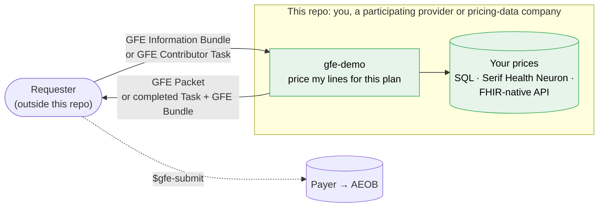
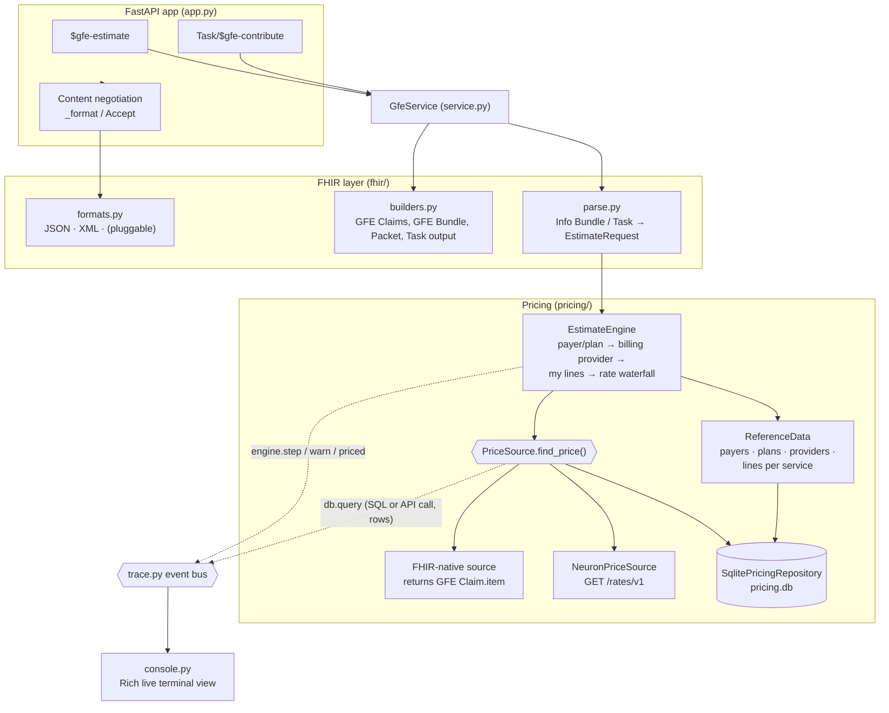
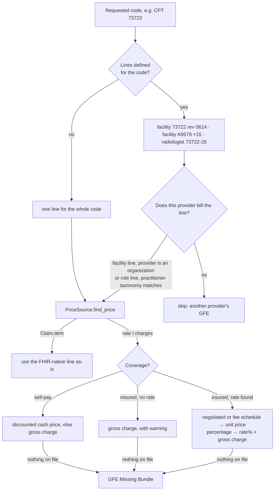
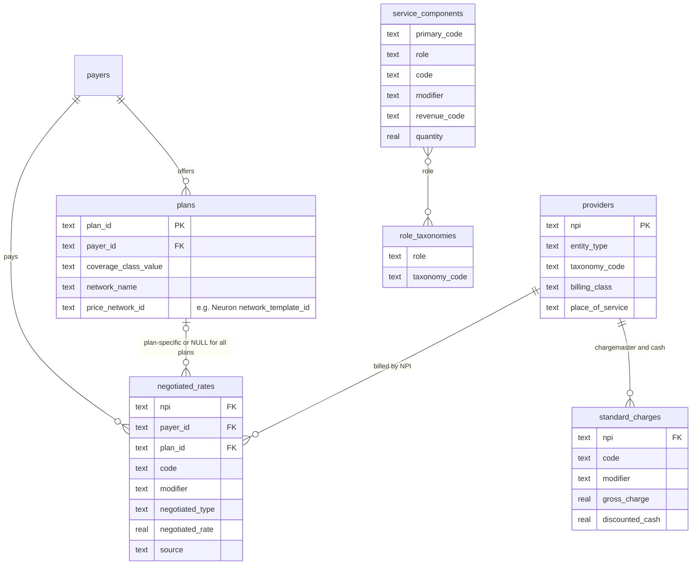

# gfe-demo: answer your piece of a Good Faith Estimate in FHIR

This is a Python service for a **provider or a pricing-data company** that needs to answer the question a
Good Faith Estimate (GFE) asks of it:

> *"What will **this provider** charge for **this service** under **this patient's plan** (or self-pay)?"*

> [!IMPORTANT]
> **The GFE coordination role is not supported in this demo.** It does not act as a convening provider
> (Coordination Requester) or a Coordination Platform. It does not create or route Contributor Tasks, gather GFEs from
> other providers, assemble a packet from other providers' responses, or look up who else should price a service. There is no
> `$gfe-coordination-request`, `$gfe-retrieve`, Task store or provider directory. If you need that role, see the PCT
> IG's [GFE coordination workflow](https://build.fhir.org/ig/HL7/davinci-pct/gfe_coordination_overview.html).

What the demo **does** show: given a request, price **your own lines** and answer with standard PCT resources.

It reads a request from the [HL7 Da Vinci Patient Cost Transparency (PCT) IG](https://build.fhir.org/ig/HL7/davinci-pct/),
looks up the price for that provider, plan and code, and answers with a **GFE Bundle** (inside a completed
Contributor Task) or a **GFE Packet**. It does not return a proprietary JSON payload. Each provider prices only what it
bills. Any line someone else bills, such as a radiologist's read on a hospital MRI, is skipped and noted in the trace.

Prices come through one swappable lookup. The demo ships three sources:

* a local SQLite database (synthetic TiC rates and chargemaster);
* the **[Serif Health Neuron API](https://neuron.serifhealth.com/swagger/openapi.json)** (live TiC + hospital price
  transparency data);
* any **FHIR-native** source that already returns PCT GFE `Claim.item`s.

Every request is traced live in the terminal: the inbound FHIR, each SQL query or API call and the rows it returned,
the pricing decisions, the FHIR that was built, and the outbound response.

> Built against the PCT continuous build (2.0.x / STU2 content):
> [GFE Bundle example](https://build.fhir.org/ig/HL7/davinci-pct/Bundle-PCT-GFE-Bundle-Inst-1.json.html) ·
> [GFE submission & AEOB overview](https://build.fhir.org/ig/HL7/davinci-pct/gfe_submission_and_aeob_overview.html).
> Pricing, provider and patient data in this repo are **synthetic**. The one exception is the live Neuron example
> (section 9), which uses a real hospital NPI and network, with prices fetched from the API at request time.

---

## Contents

1. [Where this fits in the PCT workflow](#1-where-this-fits-in-the-pct-workflow)
2. [The two ways to call the service](#2-the-two-ways-to-call-the-service)
3. [Architecture](#3-architecture)
4. [Request flow](#4-request-flow)
5. [How a price is found](#5-how-a-price-is-found)
6. [What comes back](#6-what-comes-back)
7. [Quickstart](#7-quickstart)
8. [Watching it in the terminal](#8-watching-it-in-the-terminal)
9. [Swapping the price source: SQL, Serif Health Neuron, FHIR-native](#9-swapping-the-price-source-sql-serif-health-neuron-fhir-native)
10. [Response formats](#10-response-formats)
11. [Configuration and reference data](#11-configuration-and-reference-data)
12. [Spec notes, limitations and production checklist](#12-spec-notes-limitations-and-production-checklist)
13. [Project layout and tests](#13-project-layout-and-tests)

---

## 1. Where this fits in the PCT workflow

PCT splits cost transparency into two halves. Providers produce **GFEs**. Payers turn a submitted GFE Packet into an
**Advanced EOB (AEOB)**. This repo covers only the box in green: one provider, or a data company acting for it,
answering for its own services. Whoever sends the request is outside this repo.



A hospital asked for several services (an MRI, the contrast, a knee brace) answers for all of them in one GFE Bundle.
That is still one provider pricing its own lines, not coordination.

---

## 2. The two ways to call the service

| # | Use case | Endpoint | Request | Response |
|---|---|---|---|---|
| 1 | **Direct estimate.** Price the requested services at the provider named on each one (`ServiceRequest.performer`), or at the provider the request names, or at the configured default. | `POST /fhir/$gfe-estimate` | [GFE Information Bundle](https://build.fhir.org/ig/HL7/davinci-pct/StructureDefinition-davinci-pct-gfe-information-bundle.html), bare or as `Parameters.resource` | [GFE Packet](https://build.fhir.org/ig/HL7/davinci-pct/StructureDefinition-davinci-pct-gfe-packet.html) with one [GFE Bundle](https://build.fhir.org/ig/HL7/davinci-pct/StructureDefinition-davinci-pct-gfe-bundle.html) per billing provider, plus a [GFE Missing Bundle](https://build.fhir.org/ig/HL7/davinci-pct/StructureDefinition-davinci-pct-gfe-missing-bundle.html) for any requested line that has no price on file |
| 2 | **Participating provider.** You received a [GFE Contributor Task](https://build.fhir.org/ig/HL7/davinci-pct/StructureDefinition-davinci-pct-gfe-contributor-task.html) asking for your part of an estimate. | `POST /fhir/Task/$gfe-contribute` | The Contributor Task, with the Information Bundle as a base64 `Task.input` attachment. `Task.owner` (or `?npi=`) says who you are. | The same Task, `status=completed`, with `Task.output:gfe-bundle` holding your GFE Bundle. Return it to whoever sent the Task; this demo does not talk to a platform. If you bill none of the lines, the Task comes back `failed` with a reason. |

Both endpoints are convenience operations that this demo defines; they are not part of the IG. Their inputs and outputs
are IG profiles, and both use the same parser, pricing engine and FHIR builders.

---

## 3. Architecture



The design choices that matter:

* **One seam for prices.** `PriceSource` has a single method,
  `find_price(provider, payer, plan, code_type, code, modifier, quantity, service_date) → PriceQuote`. Plugging in a
  pricing API means implementing that one call. Payers, plans, providers and service definitions stay in a small
  `ReferenceData` store.
* **Domain objects sit between FHIR and data** (`domain.py`). The engine never builds FHIR JSON. The builders never
  see SQL or vendor JSON.
* **Tracing is an event bus, not logging.** Each layer emits structured events. The Rich console is one subscriber.

---

## 4. Request flow

```mermaid
sequenceDiagram
    autonumber
    participant Req as Requester
    participant API as gfe-demo
    participant Ref as ReferenceData (SQLite)
    participant PS as PriceSource (SQLite / Neuron / FHIR-native)
    Req->>API: POST $gfe-estimate (Information Bundle)<br/>or Task/$gfe-contribute (Contributor Task)
    API->>Ref: payer + plan from Coverage (none → self-pay)
    API->>Ref: billing provider (Task.owner → performer → named provider → default)
    loop each requested code
        API->>Ref: lines billed for the code (e.g. 73722 → facility, contrast, radiologist -26)
        Note over API: keep only the lines this provider bills;<br/>skip the rest (another provider's GFE)
        API->>PS: find_price(provider, plan, code, modifier)
        PS-->>API: rate + charges, or a ready GFE Claim.item
    end
    API->>API: GFE Summary + Institutional/Professional Claim → GFE Bundle
    API-->>Req: GFE Packet, or the Task completed with the GFE Bundle
```

---

## 5. How a price is found



Each Claim line records how its price was derived (`providerEventMethodology`), including the source. For
example: *"In-network 45% of gross charge $14,800.00 - Acme Health Plan (all plans). Source:
acme_in-network-rates_2026-09.json (TiC); 041234567_bedford-regional_standardcharges.csv (hospital MRF)"*.

A **freestanding** facility (`billing_class = professional`) bills the technical component with modifier `-TC` on a
professional claim. A hospital bills on an institutional claim with a revenue code and type of bill `0131`.

### Pricing database



`negotiated_rates` mirrors a payer Transparency-in-Coverage in-network file, and `standard_charges` mirrors a hospital
price-transparency file. When prices come from Neuron, only the reference tables are used (payers, plans, providers,
service_components, role_taxonomies, code_descriptions); SQLite's cash prices and chargemaster still cover self-pay.
The full DDL is in [src/gfe_service/db/schema.sql](src/gfe_service/db/schema.sql).

---

## 6. What comes back

```text
Bundle (document)                         davinci-pct-gfe-packet          ← $gfe-estimate
├── Composition                           davinci-pct-gfe-composition   LOINC 111480-0 "Good faith estimate"
│   ├── ext requestInitiationTime · requestOriginationType (scheduled|nonscheduled) · gfeServiceLinkingInfo
│   ├── section coverage-section  → Coverage
│   └── section gfe-section × N   → one GFE Bundle per billing provider, author = that provider
├── Patient · Coverage · provider Organization · payer Organization
├── Bundle (collection)                   davinci-pct-gfe-bundle         ← e.g. the hospital
│   ├── Claim  davinci-pct-gfe-summary        total
│   ├── Claim  davinci-pct-gfe-institutional  typeOfBill, revenue codes, items, net, total
│   │          (or davinci-pct-gfe-professional: POS, modifiers -26/-TC/AA, unitPrice, net)
│   └── Patient · Coverage · payer · Organization/Practitioner (NPI, taxonomy)
└── Bundle (collection)                   davinci-pct-gfe-missing-bundle ← only if a requested line has no price

Task (davinci-pct-gfe-contributor-task, status = completed)   ← Task/$gfe-contribute
└── output gfe-bundle  valueAttachment = base64 GFE Bundle (same shape as above)
```

Run `gfe-demo send examples/information-bundle-mri-knee.json --save out.json` for a full JSON example.

---

## 7. Quickstart

You need Python 3.11+ and [uv](https://docs.astral.sh/uv/). With plain `pip`, use `pip install -e .` and drop the
`uv run` prefixes.

```bash
uv sync                      # install
uv run gfe-demo db init      # create data/pricing.db (synthetic rates, chargemaster, providers)
uv run gfe-demo demo         # every scenario in one terminal, pausing between steps
GFE_NEURON_API_KEY=… uv run gfe-demo demo   # …plus a live Serif Health Neuron scenario
```

### Two terminals: server and client

```bash
# terminal 1: the service, with a live trace of everything it receives, looks up and sends
uv run gfe-demo serve --trace summary          # or --trace full for SQL / API URLs + raw bodies

# terminal 2: send requests
uv run gfe-demo send examples/information-bundle-mri-knee.json            # → GFE Packet
uv run gfe-demo send examples/information-bundle-brain-mri-self-pay.json --format xml --raw
uv run gfe-demo send examples/contributor-task-surgeon.json               # → completed Task + GFE Bundle
```

`send` picks the endpoint from the payload: a `Task` goes to `Task/$gfe-contribute`, and anything else goes to
`$gfe-estimate`.

### Plain curl

```bash
curl -s -X POST 'http://localhost:8000/fhir/$gfe-estimate' \
     -H 'Content-Type: application/fhir+json' \
     --data @examples/information-bundle-mri-knee.json | jq '.entry[0].resource.section'
```

OpenAPI docs are served at `http://localhost:8000/docs`, and the CapabilityStatement at `/fhir/metadata`.

### Example payloads ([examples/](examples/))

| File | Scenario | Expected result |
|---|---|---|
| `information-bundle-mri-knee.json` | Umbrella "Premim Family Plus" at Bedford Regional: MRI knee w/ contrast + knee brace | One institutional GFE: 73722 $1,320 + contrast 15 × $6.50 + brace $310 = **$1,727.50**. The radiologist's -26 read is skipped. |
| `information-bundle-brain-mri-self-pay.json` | No coverage, Lexington Imaging (freestanding) | 70551-TC discounted cash **$425.00** |
| `information-bundle-knee-arthroscopy.json` | Acme HMO Gold, knee arthroscopy at Bedford | Facility 45% × $14,800 = **$6,660.00** |
| `contributor-task-surgeon.json` | Contributor Task assigned to Dr. Cutter for that arthroscopy | Task `completed`, GFE Bundle with CPT 29881 only (**$910.00**) |
| `information-bundle-emerson-brain-mri-neuron.json` | Real hospital (Emerson Hospital, NPI 1922103357), BCBS MA Blue Care Elect, CPT 70551 | **Needs `--prices neuron`.** Live TiC rate from Neuron ($1,283.50 as of Neuron's 2026-09 data). Without Neuron: 422, because no local prices exist. |
| `spec/Bundle-PCT-GFE-Information-Bundle-1.json` | The IG's own example, unmodified | Priced at the default provider (Bedford) |

The Contributor Task embeds the Information Bundle as base64 (the IG's preferred encoding). It is generated from
readable sources by `uv run gfe-demo examples`.

---

## 8. Watching it in the terminal

`gfe-demo serve` and `gfe-demo demo` render every trace event as it happens. Here is an excerpt from the surgeon's
Contributor Task (`--trace summary`):

```text
08:51:17.189 req-0003 ▶ INBOUND POST /fhir/Task/$gfe-contribute application/fhir+json 5,844 B ─────────────
╭─ request ───────────────────────────────────────────────────────────────────────────────────────────────╮
│ Task contrib-task-surgeon-1 · gfe-contributor-task · status requested · owner Practitioner/npi-1182940357 │
│ └── input gfe-information-bundle (base64 attachment)                                                    │
│     └── Bundle collection davinci-pct-gfe-information-bundle info-knee-scope-1 · 5 entries              │
│         ├── Patient Alex Rivera · female · DOB 1979-11-02                                               │
│         ├── Coverage insurance · plan Acme HMO Gold · subscriber ACM778899001                           │
│         └── ServiceRequest CPT:29881 Arthroscopy, knee, surgical; with meniscectomy                     │
╰─────────────────────────────────────────────────────────────────────────────────────────────────────────╯
  acting as         GFE Contributor NPI 1182940357
  ⚙ Coverage -> payer Acme Health Plan (acme), plan Acme HMO Gold / network Acme Core
  ⚙ Contributor Task owner -> pricing only lines billed by Sam Cutter, MD
  ⛁ 0.04 ms lines billed for CPT 29881 → 3 row(s)
     role               code    modifier   revenue_code   service_category
     facility           29881              0360           Outpatient surgery - facility
     surgeon            29881                             Surgery - professional
     anesthesiologist   01400   AA                        Anesthesia - professional
  ⚙ skip CPT 29881 (facility) - billed separately by the facility, not part of Sam Cutter, MD's GFE
  ⛁ 0.07 ms negotiated rate CPT 29881 @ NPI 1182940357 → 1 row(s)
     negotiated_type   negotiated_rate   source
     fee schedule      910.0             acme_in-network-rates_2026-09.json (TiC)
  $ CPT 29881 × 1 @ $910.00 = $910.00 · Sam Cutter, MD · In-network fee schedule rate - Acme Health Plan (all plans)
  ⚙ skip CPT 01400-AA (anesthesiologist) - billed separately by the anesthesiologist, not part of Sam Cutter, MD's GFE
╭─ response (json) ───────────────────────────────────────────────────────────────────────────────────────╮
│ Task contrib-task-surgeon-1 · gfe-contributor-task · status completed · owner Practitioner/npi-1182940357 │
│ └── output gfe-bundle (base64 attachment, 11032 chars)                                                  │
╰─────────────────────────────────────────────────────────────────────────────────────────────────────────╯
08:51:17.205 req-0003 ◀ OUTBOUND 200 POST /fhir/Task/$gfe-contribute application/fhir+json 17,289 B · 16.8 ms
```

With `--prices neuron`, the rate lookup appears as an API call instead of SQL:

```text
  ⛁ 909.63 ms Serif Health Neuron rates 70551 @ NPI 1922103357 → 2 row(s)
     entity_name       modifier_list  place_of_service  negotiation_type  rate     hpt_charge_gross  network_name
     EMERSON HOSPITAL                 22                fee schedule      1283.5   2203              Blue Care Elect
     EMERSON HOSPITAL  52             22                fee schedule      641.75   2203              Blue Care Elect
  $ CPT 70551 × 1 @ $1,283.50 = $1,283.50 · Emerson Hospital · In-network fee schedule rate - plan Blue Care Elect PPO
```

| `--trace` | Shows |
|---|---|
| `quiet` | one line per inbound and outbound message |
| `summary` *(default)* | plus the request tree, parsed request, every lookup (SQL or API) with its rows, engine decisions, priced lines, the estimate table, and the built FHIR tree |
| `full` | plus SQL text / API URLs and the raw serialized request and response bodies (`--body-lines` caps the length) |
| `off` | nothing |

---

## 9. Swapping the price source: SQL, Serif Health Neuron, FHIR-native

Everything about prices goes through [src/gfe_service/pricing/repository.py](src/gfe_service/pricing/repository.py):

```python
class PriceSource(Protocol):
    def find_price(self, *, provider, payer, plan, code_type, code, modifier, quantity, service_date) -> PriceQuote: ...

@dataclass
class PriceQuote:
    rate: Rate | None = None                   # in-network rate (TiC negotiated_type / negotiated_rate)
    charge: StandardCharge | None = None       # gross charge / discounted cash (hospital MRF, fee schedule)
    claim_item: dict | None = None             # FHIR-native: a ready PCT GFE Claim.item
```

`payer` is `None` for self-pay. To add a source, implement `find_price` and pair it with the local reference data:

```python
from gfe_service.app import create_app
from gfe_service.pricing.repository import CompositeRepository, SqlitePricingRepository

local = SqlitePricingRepository("data/pricing.db")
app = create_app(repo=CompositeRepository(local, MyPriceSource()))
```

### Serif Health Neuron (built in)

[src/gfe_service/pricing/neuron.py](src/gfe_service/pricing/neuron.py) implements `PriceSource` with one
[`GET /rates/v1`](https://neuron.serifhealth.com/swagger/openapi.json) call per GFE line:

```text
GET https://neuron.serifhealth.com/api/rates/v1?codes=70551&npis=1922103357
    &network_template_ids=50ec662e-…&billing_classes=institutional&additional_fields=hpt_charge_gross,hpt_dollar
X-API-KEY: $GFE_NEURON_API_KEY
```

```bash
export GFE_NEURON_API_KEY=…                          # never commit this (.env files are git-ignored)
uv run gfe-demo serve --prices neuron
uv run gfe-demo send examples/information-bundle-emerson-brain-mri-neuron.json
```

How the adapter maps a Neuron response:

| Neuron `rateV1` | Becomes |
|---|---|
| `rate`, `negotiation_type` (`negotiated`, `fee schedule`, `percentage`…) | `Rate`. For `percentage`, `rate` is the percent, and it is applied to `hpt_charge_gross`. |
| `hpt_charge_gross` | `StandardCharge.gross_charge`: the hospital's billed charge, used for %-of-charges and cited in the methodology |
| `payer_name`, `network_name`, `network_year_month` | the `providerEventMethodology` source text |
| `expiration` | rate in effect for the planned service date? |
| `modifier_list`, `place_of_service`, `arrangement` | row selection: exact modifier match; prefer the provider's POS and fee-for-service, then the highest rate (the estimate shouldn't under-quote) |

Requirements and behavior:

* **Network mapping.** Neuron searches by payer network, so each plan in `plans` needs its Neuron
  `network_template_id` in `price_network_id` (list them with `GET /networks/v1/templates`).
* **Fallback to local prices.** Self-pay requests, plans without a network id, and Neuron outages fall back to SQLite
  (the provider's own cash prices and chargemaster). The trace shows each fallback.

The only vendor-specific code is `rate_from_neuron` / `charge_from_neuron`: about 20 lines of field mapping. The engine
then runs the same waterfall it runs for SQL, and the builders produce the same FHIR.

### FHIR-native sources: hand back a GFE `Claim.item`

If your pricing API can already speak PCT, skip the translation entirely. Return the line as a PCT GFE `Claim.item`,
and it is placed in the GFE Claim verbatim:

```python
class MyFhirPriceSource:
    def find_price(self, *, provider, payer, plan, code_type, code, modifier, quantity, service_date):
        item = my_api.get_gfe_item(npi=provider.npi, plan=plan and plan.plan_id, code=code, modifier=modifier)
        return PriceQuote(claim_item=item)   # or PriceQuote() when you have no price
```

```json
{
  "extension": [{"url": "http://hl7.org/fhir/us/davinci-pct/StructureDefinition/providerEventMethodology",
                 "valueString": "Contracted rate, BCBS MA Blue Care Elect"}],
  "revenue": {"coding": [{"system": "https://www.nubc.org/CodeSystem/RevenueCodes", "code": "0611"}]},
  "productOrService": {"coding": [{"system": "http://www.ama-assn.org/go/cpt", "code": "70551"}]},
  "quantity": {"value": 1},
  "unitPrice": {"value": 1283.50, "currency": "USD"},
  "net": {"value": 1283.50, "currency": "USD"}
}
```

`Claim.item` carries the expected (negotiated) amount in `unitPrice`/`net`, which is what the GFE needs. The service
adds only what the price source can't know from the request: `sequence`, `servicedDate`/`servicedPeriod`, the
`serviceDescription` and line-control-number extensions, and the professional `locationCodeableConcept` when it is
missing. No custom extensions are involved. We considered FHIR `ChargeItemDefinition`, but it has no native slot for
the billing provider or the modifier. The GFE line is the simpler, already-standard contract.

### Your own warehouse

To read from Postgres, Snowflake, BigQuery or similar instead, implement `find_price` (and `ReferenceData`, if you
want those tables there too). Call `trace_lookup(...)` to show your queries in the terminal view. To keep SQLite, load
CSVs whose header names match the column names: `uv run gfe-demo db load negotiated_rates my_rates.csv` (or
`standard_charges`, `providers`, `plans`, `service_components`, …).

---

## 10. Response formats

PCT examples use JSON, and JSON is the default. Formats are negotiated per request:

| Ask with | Gets |
|---|---|
| nothing, `Accept: */*`, `application/json`, `application/fhir+json`, `?_format=json` | `application/fhir+json` |
| `Accept: application/fhir+xml` / `application/xml`, `?_format=xml` | `application/fhir+xml` (R4 XML rules: `@value`, `extension/@url`, wrapped inline resources) |
| anything else | `406` + OperationOutcome |
| `?_pretty=false` | compact output |

To add a format, such as a patient-facing HTML/PDF rendering of the packet, register it in
[src/gfe_service/fhir/formats.py](src/gfe_service/fhir/formats.py). Every endpoint and the CapabilityStatement pick it
up automatically:

```python
from gfe_service.fhir.formats import ResponseFormat, register
register(ResponseFormat("html", "text/html", ("html", "text/html"), render_packet_as_html))
```

Request bodies are FHIR JSON. XML request bodies get `415`.

---

## 11. Configuration and reference data

| Variable | Default | Meaning |
|---|---|---|
| `GFE_DB_PATH` | `data/pricing.db` | SQLite file (reference data + local prices) |
| `GFE_PRICE_SOURCE` | `sqlite` | `sqlite` or `neuron` (same as `serve --prices`) |
| `GFE_NEURON_API_KEY` | – | Serif Health Neuron API key (sent as `X-API-KEY`) |
| `GFE_NEURON_URL` | `https://neuron.serifhealth.com/api` | Neuron base URL |
| `GFE_FHIR_BASE` | `http://localhost:<port>/fhir` | Used for `fullUrl`s and identifier systems |
| `GFE_DEFAULT_PROVIDER_NPI` | `1520397849` | Provider used when a request names none (single-facility deployments) |
| `GFE_TRACE_BODY_LINES` | `80` | Max raw-body lines printed by the in-process demo at `--trace full` |
| `GFE_DISCLAIMER` | estimation disclaimer | Text placed in `gfeDisclaimer` |

Providers in the seed data:

| NPI | Provider | Billing |
|---|---|---|
| 1520397849 | Bedford Regional Medical Center (hospital) | institutional, POS 22 |
| 1620483911 | Lexington Imaging Center (freestanding) | professional, POS 11 |
| 1430572606 | Nora Ologist, MD (radiology) | professional |
| 1182940357 | Sam Cutter, MD (orthopaedic surgery) | professional |
| 1273650485 | Ana Sthesia, MD (anesthesiology) | professional |
| 1394820173 | Pat Thera, PT (no pricing loaded; shows a failed Contributor Task) | professional |
| 1922103357 | Emerson Hospital, Concord MA. **Real, public NPI with no local prices**; priced live via Neuron (BCBS MA Blue Care Elect) | institutional, POS 22 |

---

## 12. Spec notes, limitations and production checklist

**Aligned with the IG**

* Output profiles: GFE Packet, GFE Composition, GFE Bundle, GFE Missing Bundle, GFE Summary, GFE Institutional and GFE
  Professional Claims, PCT Organization, Practitioner and Coverage, and the GFE Contributor Task output slice.
* Required elements of those profiles are pinned by the tests in [tests/conformance.py](tests/conformance.py), for
  example `identifier:PLAC`, `providerTaxonomy`, institutional `typeOfBill` and `item.revenue`, professional
  `item.location[x]` and `unitPrice`, and a summary `provider` using `data-absent-reason`. FHIR-native `Claim.item`s
  from a price source pass the same checks.
* Self-pay requests get a PCT Coverage with `Coverage.kind = self-pay`.

**Not supported**

* **The coordination role.** See the notice at the top. As a result, a Contributor Task is accepted only with the
  Information Bundle attached (not as a reference to resolve), and `gfeServiceLinkingInfo` carries only the planned
  period of service. No `linkingIdentifier` is set.
* `$gfe-estimate` and `Task/$gfe-contribute` are **convenience operations, not part of the IG**.

**Simplifications**

* Anesthesia is priced as a flat case rate. Base-plus-time-unit math (Neuron returns `anesthesia_*` fields) and DRG
  per-case/per-diem pricing are extension points.
* When Neuron returns several matching rows, the adapter picks one deterministically (see section 9) instead of
  reporting a range.

**Before production**

* Security: SMART Backend Services / UDAP auth, TLS, audit logging. These payloads contain PHI. Keep the Neuron key in
  a secret store.
* Cache Neuron lookups per provider/code/network (rates change monthly).
* Run the official validator against the IG:
  `java -jar validator_cli.jar packet.json -version 4.0.1 -ig hl7.fhir.us.davinci-pct#current`.

---

## 13. Project layout and tests

```text
src/gfe_service/
├── app.py               FastAPI routes, price-source selection, content negotiation, OperationOutcome errors
├── service.py           use cases: Information Bundle → Packet, Contributor Task → completed Task
├── domain.py            plain dataclasses between FHIR and pricing
├── fhir/
│   ├── constants.py     PCT profile / extension / code system URLs
│   ├── parse.py         Information Bundle, Task, Parameters parsing → EstimateRequest
│   ├── builders.py      Claims, GFE Bundle, Missing Bundle, Composition, Packet, Task output
│   └── formats.py       response format registry (JSON, XML)
├── pricing/
│   ├── repository.py    ReferenceData + PriceSource protocols, PriceQuote, SQLite + composite implementations
│   ├── neuron.py        Serif Health Neuron PriceSource
│   └── engine.py        payer/plan, billing provider, this provider's lines, rate waterfall
├── db/                  schema.sql, seed data, init + CSV loader
├── demo/                example payload generator, in-process demo runner
├── trace.py             event bus
├── console.py           Rich terminal renderer
└── cli.py               `gfe-demo` command
examples/                request payloads (+ spec/ copy of the IG example)
tests/                   pytest: estimate, contributor, price sources (Neuron mock + live, FHIR-native), formats, conformance
```

```bash
uv run pytest                                  # live Neuron test runs only when GFE_NEURON_API_KEY is set
```

---

## License

[MIT](LICENSE)
