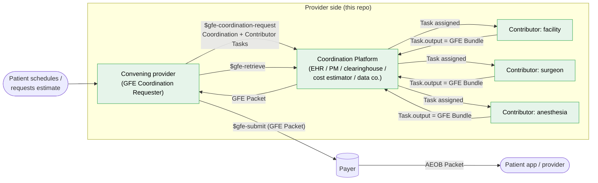
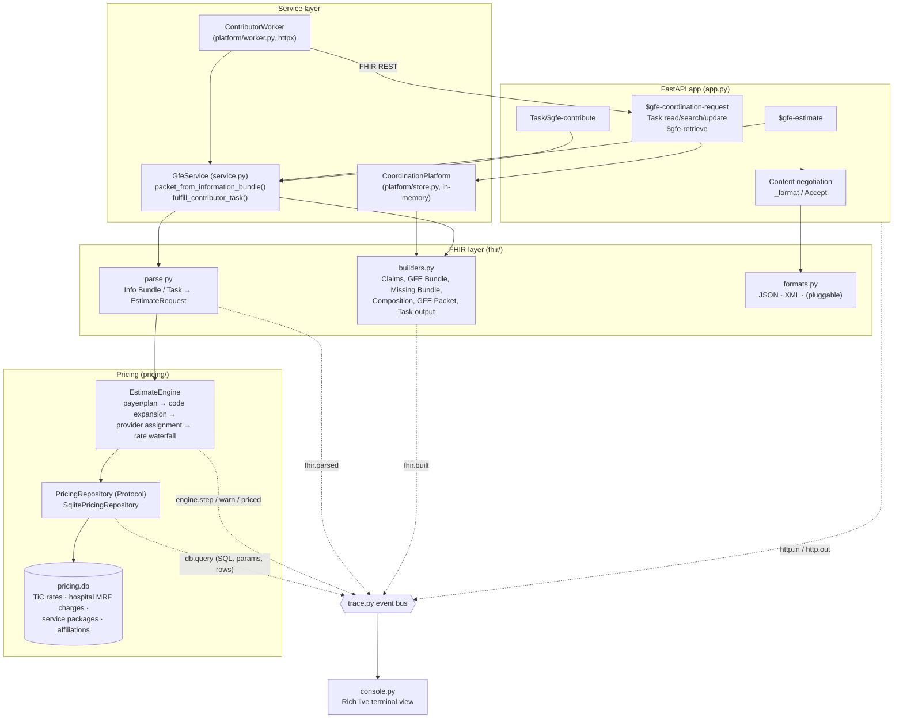
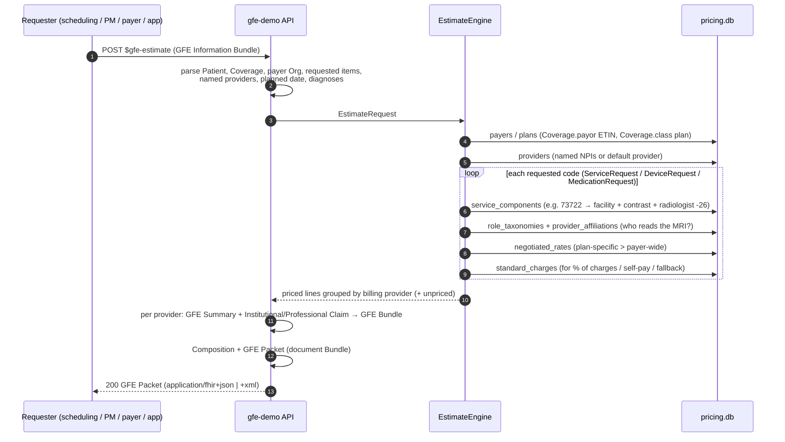
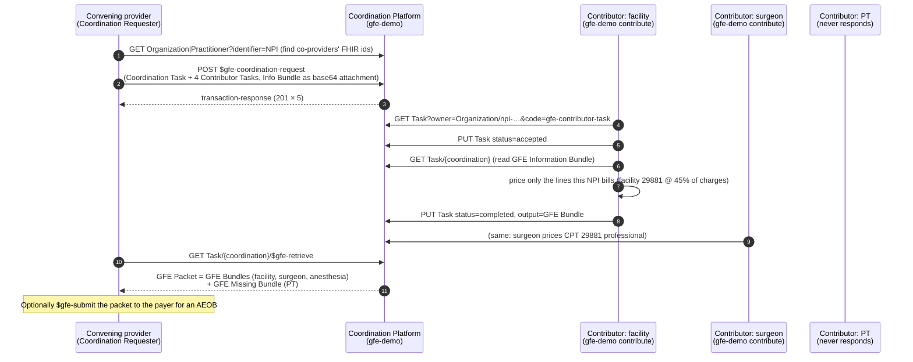
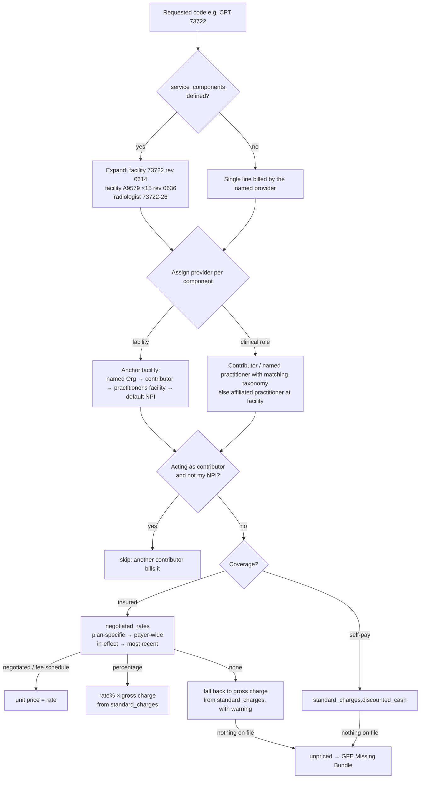
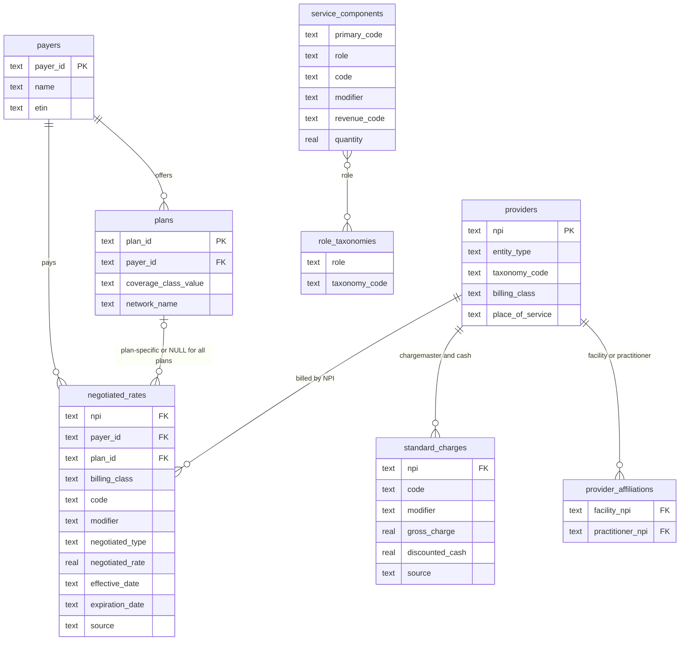

# gfe-demo: answer Good Faith Estimate requests in FHIR

This is a Python service that receives a **Good Faith Estimate (GFE) request**, looks up the billable codes and
rendering providers in a **pricing database**, and returns a standards-based response from the
[HL7 Da Vinci Patient Cost Transparency (PCT) IG](https://build.fhir.org/ig/HL7/davinci-pct/). The response is a
**GFE Bundle**, or a full **GFE Packet**. It is not a proprietary JSON payload.

It is aimed at two kinds of teams:

* **A provider taking part in a GFE.** That can be a co-provider asked for its share of a multi-provider estimate
  (a *GFE Contributor*) or the provider who schedules the service (the *convening provider*, or *Coordination
  Requester*).
* **A pricing-data company** such as Serif Health, a clearinghouse, or a cost estimator. These companies already
  hold negotiated rates and chargemasters and can answer for a provider (or act as the *Coordination Platform*)
  using the FHIR resources payers and other providers already consume.

Every request is traced live in the terminal. You see the inbound FHIR, each database lookup and the rows it
returned, the pricing decisions, the FHIR that was built, and the outbound response.

> Built against the PCT continuous build (2.0.x / STU2 content):
> [GFE Bundle example](https://build.fhir.org/ig/HL7/davinci-pct/Bundle-PCT-GFE-Bundle-Inst-1.json.html) ·
> [GFE submission & AEOB overview](https://build.fhir.org/ig/HL7/davinci-pct/gfe_submission_and_aeob_overview.html) ·
> [GFE coordination overview](https://build.fhir.org/ig/HL7/davinci-pct/gfe_coordination_overview.html).
> All pricing, provider and patient data in this repo is **synthetic**.

---

## Contents

1. [Where this fits in the PCT workflow](#1-where-this-fits-in-the-pct-workflow)
2. [The three ways to use the service](#2-the-three-ways-to-use-the-service)
3. [Architecture](#3-architecture)
4. [Request flows](#4-request-flows)
5. [How a price is found](#5-how-a-price-is-found)
6. [What comes back: anatomy of a GFE Packet](#6-what-comes-back-anatomy-of-a-gfe-packet)
7. [Quickstart](#7-quickstart)
8. [Watching it in the terminal](#8-watching-it-in-the-terminal)
9. [Response formats](#9-response-formats)
10. [Plugging in your own data](#10-plugging-in-your-own-data)
11. [Spec notes, limitations and production checklist](#11-spec-notes-limitations-and-production-checklist)
12. [Project layout and tests](#12-project-layout-and-tests)

---

## 1. Where this fits in the PCT workflow

PCT splits cost transparency into two halves. Providers produce **GFEs**. Payers turn a submitted GFE Packet
into an **Advanced EOB (AEOB)**. This service owns the provider half: it turns pricing data into GFEs.



The green boxes are roles this service can play. A single provider is often more than one of them: the facility
that schedules a surgery is both the **Coordination Requester** and a **Contributor**.

---

## 2. The three ways to use the service

| # | Use case | Endpoint | Request | Response | Spec status |
|---|---|---|---|---|---|
| 1 | **Direct estimate.** A data company or single provider answers an estimate request without running a coordination workflow. | `POST /fhir/$gfe-estimate` | [GFE Information Bundle](https://build.fhir.org/ig/HL7/davinci-pct/StructureDefinition-davinci-pct-gfe-information-bundle.html), bare or as `Parameters.resource` | [GFE Packet](https://build.fhir.org/ig/HL7/davinci-pct/StructureDefinition-davinci-pct-gfe-packet.html) (one GFE Bundle per billing provider, plus a Missing Bundle for anything that couldn't be priced) | Convenience operation (not in the IG). Input and output are IG profiles. |
| 2 | **Participating provider.** You are a GFE Contributor. | `POST /fhir/Task/$gfe-contribute` | [GFE Contributor Task](https://build.fhir.org/ig/HL7/davinci-pct/StructureDefinition-davinci-pct-gfe-contributor-task.html) with the Information Bundle in `Task.input` | The same Task, `status=completed`, with `Task.output:gfe-bundle` holding a [GFE Bundle](https://build.fhir.org/ig/HL7/davinci-pct/StructureDefinition-davinci-pct-gfe-bundle.html). This is exactly the Task a contributor `PUT`s back to the platform. | Convenience operation (not in the IG). The Task shape is the IG profile. |
| 2b | **Participating provider, pull model.** | `gfe-demo contribute --npi … --platform-url …` | Polls any Coordination Platform over FHIR REST | `PUT Task/{id}` → `accepted`, then `completed` with the GFE Bundle | Follows the IG workflow (steps 3–7) |
| 3 | **Coordinating / platform.** You are the convening provider or the platform. | `POST /fhir/$gfe-coordination-request`<br/>`GET\|PUT /fhir/Task/…`<br/>`GET\|POST /fhir/Task/{id}/$gfe-retrieve` | [GFE Coordination Bundle](https://build.fhir.org/ig/HL7/davinci-pct/StructureDefinition-davinci-pct-gfe-coordination-bundle.html) | Transaction-response, then a **GFE Packet** assembled from completed Tasks plus [GFE Missing Bundles](https://build.fhir.org/ig/HL7/davinci-pct/StructureDefinition-davinci-pct-gfe-missing-bundle.html) for contributors that haven't responded | IG operations [`$gfe-coordination-request`](https://build.fhir.org/ig/HL7/davinci-pct/OperationDefinition-GFE-coordination-request.html) and [`$gfe-retrieve`](https://build.fhir.org/ig/HL7/davinci-pct/OperationDefinition-GFE-retrieve.html) |

All three use the same parser, pricing engine and FHIR builders. The only difference between them is how the
request arrives and how the result is wrapped.

---

## 3. Architecture



The design choices that matter:

* **The pricing store sits behind `PricingRepository`.** It is a `Protocol` with about ten lookups. Swap SQLite
  for Postgres, Snowflake, BigQuery or an internal pricing API without touching any FHIR code.
* **Domain objects sit between FHIR and SQL** (`domain.py`). The engine never sees FHIR JSON and the builders
  never see SQL.
* **Tracing is an event bus, not logging.** Each layer emits structured events. The Rich console is one
  subscriber; you could add OpenTelemetry or an audit log as another.
* **Formats are a registry.** The endpoints return a Python dict, and `formats.py` serializes it for whatever
  the client negotiated.

---

## 4. Request flows

### 4.1 Direct estimate: `POST /fhir/$gfe-estimate`



### 4.2 Coordinated multi-provider GFE



Every GFE produced for one coordination shares the same `gfeServiceLinkingInfo.linkingIdentifier`, taken from
the Coordination Task identifier. That way a payer can match up the pieces even if they arrive separately.

---

## 5. How a price is found



Each Claim line records how its price was derived (`providerEventMethodology`), including the source file. For
example: *"In-network 45% of gross charge $14,800.00, Acme Health Plan (all plans). Source:
acme_in-network-rates_2026-09.json (TiC); 041234567_bedford-regional_standardcharges.csv (hospital MRF)"*.

A **freestanding** facility (`billing_class = professional`) bills the technical component with modifier `-TC`
on a professional claim. A hospital bills it on an institutional claim with a revenue code and type of bill
`0131`.

### Pricing database



`negotiated_rates` mirrors the normalized columns of a payer Transparency-in-Coverage in-network file.
`standard_charges` mirrors a hospital price-transparency file. `service_components` and `provider_affiliations`
are the "what gets billed, and by whom" knowledge that turns one ordered CPT code into a complete,
multi-provider estimate. The full DDL is in [src/gfe_service/db/schema.sql](src/gfe_service/db/schema.sql).

---

## 6. What comes back: anatomy of a GFE Packet

```text
Bundle (document)                         davinci-pct-gfe-packet
├── Composition                           davinci-pct-gfe-composition   LOINC 111480-0 "Good faith estimate"
│   ├── ext requestInitiationTime · requestOriginationType (scheduled|nonscheduled) · gfeServiceLinkingInfo
│   ├── section coverage-section  → Coverage
│   └── section gfe-section × N   → one GFE Bundle (or Missing Bundle) each, author = that provider
├── Patient · Coverage · initiating provider · payer Organization
├── Bundle (collection)                   davinci-pct-gfe-bundle         ← facility
│   ├── Claim  davinci-pct-gfe-summary        total
│   ├── Claim  davinci-pct-gfe-institutional  typeOfBill, revenue codes, items, net, total
│   └── Patient · Coverage · payer · Organization (NPI, taxonomy)
├── Bundle (collection)                   davinci-pct-gfe-bundle         ← radiologist / surgeon / anesthesia
│   ├── Claim  davinci-pct-gfe-summary
│   ├── Claim  davinci-pct-gfe-professional   POS, modifiers (-26/-TC/AA), unitPrice, net
│   └── Patient · Coverage · payer · Practitioner
└── Bundle (collection)                   davinci-pct-gfe-missing-bundle ← provider that didn't / couldn't respond
```

Run `gfe-demo send examples/information-bundle-mri-knee.json --save out.json` to get a full JSON example.

---

## 7. Quickstart

You need Python 3.11+ and [uv](https://docs.astral.sh/uv/). With plain `pip`, use `pip install -e .` and drop the
`uv run` prefixes.

```bash
uv sync                      # install
uv run gfe-demo db init      # create data/pricing.db with synthetic TiC rates, chargemaster, providers
uv run gfe-demo demo         # every scenario in one terminal, pausing between steps
```

### Two terminals: server and client

```bash
# terminal 1: the service, with a live trace of everything it receives, looks up and sends
uv run gfe-demo serve --trace summary          # or --trace full for SQL text + raw bodies

# terminal 2: send requests
uv run gfe-demo send examples/information-bundle-mri-knee.json            # → GFE Packet
uv run gfe-demo send examples/information-bundle-brain-mri-self-pay.json --format xml --raw
uv run gfe-demo send examples/contributor-task-surgeon.json               # → completed Task + GFE Bundle

# coordinated flow: requester → platform → three contributors → packet
uv run gfe-demo send examples/coordination-bundle-knee-arthroscopy.json
uv run gfe-demo contribute --npi 1520397849    # Bedford Regional (facility)
uv run gfe-demo contribute --npi 1182940357    # Dr. Cutter (surgeon)
uv run gfe-demo contribute --npi 1273650485    # Dr. Sthesia (anesthesia)
uv run gfe-demo retrieve coord-knee-scope-1 --save packet.json   # PT never answered → Missing Bundle
```

`send` picks the endpoint from the payload: Bundle `collection` goes to `$gfe-estimate`, `Task` goes to
`Task/$gfe-contribute`, and Bundle `transaction` goes to `$gfe-coordination-request`.

### Plain curl

```bash
curl -s -X POST 'http://localhost:8000/fhir/$gfe-estimate' \
     -H 'Content-Type: application/fhir+json' \
     --data @examples/information-bundle-mri-knee.json | jq '.entry[0].resource.section'

curl -s -X POST 'http://localhost:8000/fhir/$gfe-estimate?_format=xml' \
     -H 'Content-Type: application/fhir+json' --data @examples/information-bundle-mri-knee.json | head -40
```

OpenAPI docs are served at `http://localhost:8000/docs` and the CapabilityStatement at `/fhir/metadata`.

### Example payloads ([examples/](examples/))

| File | Scenario | Expected result |
|---|---|---|
| `information-bundle-mri-knee.json` | Umbrella "Premim Family Plus", Bedford Regional, MRI knee w/ contrast + knee brace | Bedford institutional $1,727.50 + Dr. Ologist -26 $98.00 = **$1,825.50** |
| `information-bundle-brain-mri-self-pay.json` | No coverage, Lexington Imaging (freestanding) | 70551-TC $425 + 70551-26 $110 = **$535.00** cash |
| `information-bundle-knee-arthroscopy.json` | Acme HMO Gold, knee arthroscopy | facility 45% × $14,800 = $6,660, surgeon $910, anesthesia $655 |
| `contributor-task-surgeon.json` | Contributor Task for Dr. Cutter | Task `completed`, GFE Bundle with CPT 29881 only ($910) |
| `coordination-bundle-knee-arthroscopy.json` | Coordination + 4 Contributor Tasks | Packet with 3 GFE Bundles + 1 Missing Bundle (PT) |
| `spec/Bundle-PCT-GFE-Information-Bundle-1.json` | The IG's own example, unmodified | Priced against the default provider |

The Task and Coordination examples embed the Information Bundle as base64 (the IG's preferred encoding). They
are generated from readable sources by `uv run gfe-demo examples`.

---

## 8. Watching it in the terminal

`gfe-demo serve` and `gfe-demo demo` render every trace event as it happens. Here is an excerpt from a
contributor request (`--trace summary`):

```text
08:51:17.189 req-0003 ▶ INBOUND POST /fhir/Task/$gfe-contribute application/fhir+json 5,844 B ──────────────
╭─ request ──────────────────────────────────────────────────────────────────────────────────────────────╮
│ Task contrib-task-surgeon-1 · gfe-contributor-task · status requested · owner Practitioner/npi-1182940357 │
│ └── input gfe-information-bundle (base64 attachment)                                                   │
│     └── Bundle collection davinci-pct-gfe-information-bundle info-knee-scope-1 · 5 entries             │
│         ├── Patient Alex Rivera · female · DOB 1979-11-02                                              │
│         ├── Coverage insurance · plan Acme HMO Gold · subscriber ACM778899001                          │
│         └── ServiceRequest CPT:29881 Arthroscopy, knee, surgical; with meniscectomy                    │
╰────────────────────────────────────────────────────────────────────────────────────────────────────────╯
  acting as         GFE Contributor NPI 1182940357
  ⛁ 0.08 ms resolve payer from Coverage.payor Organization → 1 row(s)
     payer_id   name               etin
     acme       Acme Health Plan   ETIN-4400001
  ⛁ 0.01 ms expand CPT 29881 into billable components → 3 row(s)
     role               code    modifier   revenue_code   service_category
     facility           29881              0360           Outpatient surgery - facility
     surgeon            29881                             Surgery - professional
     anesthesiologist   01400   AA                        Anesthesia - professional
  ⚙ skip 29881 (facility) - billed by Bedford Regional Medical Center, not this contributor
  ⚙ surgeon for 29881: Sam Cutter, MD (named in request)
  ⛁ 0.02 ms negotiated rate CPT 29881 @ NPI 1182940357 → 1 row(s)
     negotiated_type   negotiated_rate   source
     fee schedule      910.0             acme_in-network-rates_2026-09.json (TiC)
  $ CPT 29881 × 1 @ $910.00 = $910.00 · Sam Cutter, MD · In-network fee schedule rate - Acme Health Plan
╭─ response (json) ──────────────────────────────────────────────────────────────────────────────────────╮
│ Task contrib-task-surgeon-1 · gfe-contributor-task · status completed · owner Practitioner/npi-1182940357 │
│ └── output gfe-bundle (base64 attachment, 11032 chars)                                                 │
╰────────────────────────────────────────────────────────────────────────────────────────────────────────╯
08:51:17.205 req-0003 ◀ OUTBOUND 200 POST /fhir/Task/$gfe-contribute application/fhir+json 17,289 B · 16.8 ms
```

| `--trace` | Shows |
|---|---|
| `quiet` | one line per inbound and outbound message |
| `summary` *(default)* | plus the request tree, parsed request, every DB lookup with its returned rows, engine decisions, priced lines, estimate table, and the built FHIR tree |
| `full` | plus SQL text and parameters, and the raw serialized request and response bodies (`--body-lines` caps the length) |
| `off` | nothing |

The `contribute` worker also traces its own outbound HTTP calls (`→ CONTRIBUTOR GET …` / `← 200`), so with
`serve` in one terminal and `contribute` in another you can watch both sides of every exchange.

---

## 9. Response formats

PCT examples use JSON, and JSON is the default. Formats are negotiated per request:

| Ask with | Gets |
|---|---|
| nothing, `Accept: */*`, `application/json`, `application/fhir+json`, `?_format=json` | `application/fhir+json` |
| `Accept: application/fhir+xml` / `application/xml`, `?_format=xml` | `application/fhir+xml` (R4 XML rules: `@value`, `extension/@url`, wrapped inline resources) |
| anything else | `406` + OperationOutcome |
| `?_pretty=false` | compact output |

To add a format, such as a patient-facing HTML/PDF rendering of the packet or FHIR Turtle, register it in
[src/gfe_service/fhir/formats.py](src/gfe_service/fhir/formats.py). Every endpoint and the CapabilityStatement
pick it up automatically:

```python
from gfe_service.fhir.formats import ResponseFormat, register
register(ResponseFormat("html", "text/html", ("html", "text/html"), render_packet_as_html))
```

Request bodies are FHIR JSON. XML request bodies get `415`.

---

## 10. Plugging in your own data

* **Load CSVs** into any table. Header names must match the column names:
  `uv run gfe-demo db load negotiated_rates my_rates.csv` (or `standard_charges`, `providers`,
  `service_components`, …). `uv run gfe-demo db show negotiated_rates` shows what's loaded.
* **Point at your warehouse.** Implement `PricingRepository` in
  [src/gfe_service/pricing/repository.py](src/gfe_service/pricing/repository.py) and pass it to
  `create_app(repo=…)`. Emit `tracer.emit("db.query", …)` if you want the lookups in the terminal view.
* **Configuration** (environment variables):

| Variable | Default | Meaning |
|---|---|---|
| `GFE_DB_PATH` | `data/pricing.db` | SQLite file |
| `GFE_FHIR_BASE` | `http://localhost:<port>/fhir` | Used for `fullUrl`s and identifier systems |
| `GFE_DEFAULT_PROVIDER_NPI` | `1520397849` | Provider used when a request names none (single-facility deployments) |
| `GFE_TRACE_BODY_LINES` | `80` | Max raw-body lines printed by the in-process demo at `--trace full` |
| `GFE_DISCLAIMER` | estimation disclaimer | Text placed in `gfeDisclaimer` |

Synthetic NPIs in the seed data:

| NPI | Provider | Billing |
|---|---|---|
| 1520397849 | Bedford Regional Medical Center (hospital) | institutional, POS 22 |
| 1620483911 | Lexington Imaging Center (freestanding) | professional, POS 11 |
| 1430572606 | Nora Ologist, MD (radiology) | professional |
| 1182940357 | Sam Cutter, MD (orthopaedic surgery) | professional |
| 1273650485 | Ana Sthesia, MD (anesthesiology) | professional |
| 1394820173 | Pat Thera, PT (no pricing loaded, used to show Missing Bundles and failed Tasks) | professional |

---

## 11. Spec notes, limitations and production checklist

**Aligned with the IG**

* Output profiles: GFE Packet, GFE Composition, GFE Bundle, GFE Missing Bundle, GFE Summary, GFE
  Institutional and GFE Professional Claims, PCT Organization, Practitioner and Coverage, and the GFE Contributor
  Task output slice.
* Required elements of those profiles are pinned by the tests in
  [tests/conformance.py](tests/conformance.py). Examples: `identifier:PLAC`, `providerTaxonomy`, institutional
  `typeOfBill` and `item.revenue`, professional `item.location[x]` and `unitPrice`, a summary `provider` using
  `data-absent-reason`, Composition extensions and sections, and every section entry contained in the document.
* `$gfe-coordination-request` and `$gfe-retrieve` follow the IG OperationDefinitions. Contributors that haven't
  completed their Task become GFE Missing Bundles, as the IG describes.
* Self-pay requests get a PCT Coverage with `Coverage.kind = self-pay`. The packet's coverage section is 1..1.

**Deliberate simplifications**

* `$gfe-estimate` and `Task/$gfe-contribute` are **convenience operations, not part of the IG**. They give a data
  company or a contributor one call that does what the IG expresses as a REST exchange (read Task, then `PUT`
  Task). The `contribute` worker shows the IG-native REST version.
* The Coordination Platform keeps state **in memory** and sends no Subscription notifications. Contributors poll.
  Its participant directory is seeded from the `providers` table for convenience.
* Composition `author`s and `section.author`s for providers whose resources live only inside a nested GFE Bundle
  are **logical references** (NPI identifier + display). The packet's top-level Organization/Practitioner slices
  are capped at the initiating provider and the payer.
* Anesthesia is priced as a flat case rate. Base-plus-time-unit math and DRG per-case/per-diem inpatient pricing
  are left as extension points (`negotiated_type` already allows `per diem`).
* XML output follows the JSON element order, which the builders emit in FHIR definition order.

**Before production**

* Security: SMART Backend Services / UDAP auth, TLS, audit logging. These payloads contain PHI.
* Persist platform state and implement the PCT
  [Subscription topics](https://build.fhir.org/ig/HL7/davinci-pct/gfe_coordination_overview.html#notifications).
* Run the official validator against the IG:
  `java -jar validator_cli.jar packet.json -version 4.0.1 -ig hl7.fhir.us.davinci-pct#current`
  (requires a Java runtime, which this repo doesn't install).
* Add `$gfe-submit` to a payer endpoint if you also want AEOBs.

---

## 12. Project layout and tests

```text
src/gfe_service/
├── app.py               FastAPI routes, content negotiation, OperationOutcome errors, http trace
├── service.py           use cases: Information Bundle → Packet, Contributor Task → completed Task
├── domain.py            plain dataclasses between FHIR and pricing
├── fhir/
│   ├── constants.py     PCT profile / extension / code system URLs
│   ├── parse.py         Information Bundle, Task, Parameters parsing → EstimateRequest
│   ├── builders.py      Claims, GFE Bundle, Missing Bundle, Composition, Packet, Task output
│   └── formats.py       response format registry (JSON, XML)
├── pricing/
│   ├── repository.py    PricingRepository protocol + traced SQLite implementation
│   └── engine.py        payer/plan resolution, code expansion, provider assignment, rate waterfall
├── platform/
│   ├── store.py         in-memory Coordination Platform + $gfe-retrieve
│   └── worker.py        GFE Contributor worker (httpx)
├── db/                  schema.sql, synthetic seed data, init + CSV loader
├── demo/                example payload generator, in-process demo runner
├── trace.py             event bus
├── console.py           Rich terminal renderer
└── cli.py               `gfe-demo` command
examples/                request payloads (+ spec/ copy of the IG example)
tests/                   pytest: estimate, contributor, coordination, formats, profile conformance
```

```bash
uv run pytest
```
